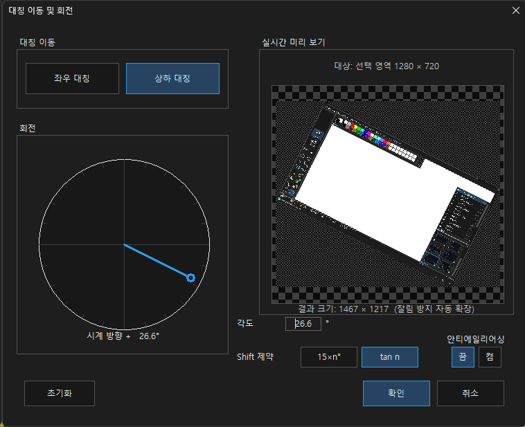
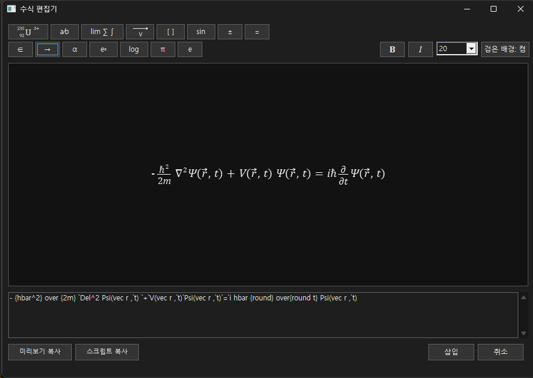
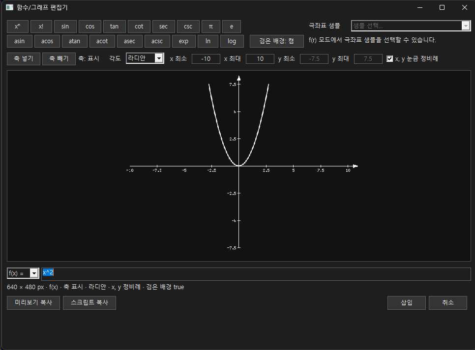
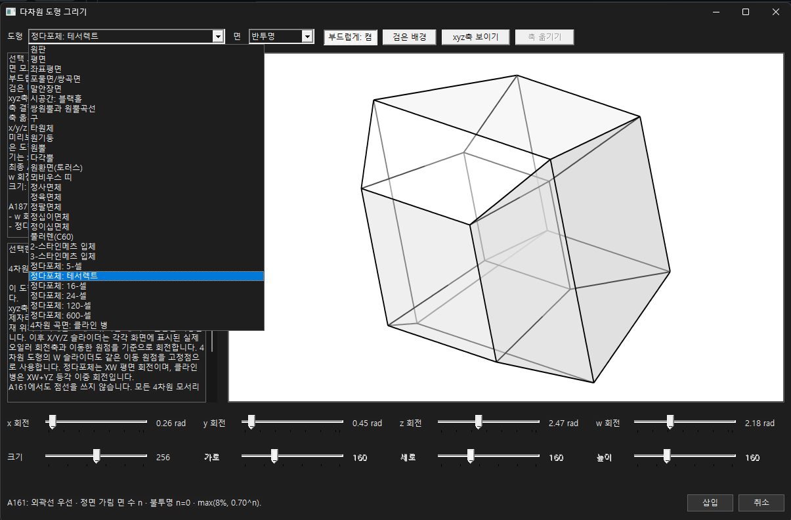
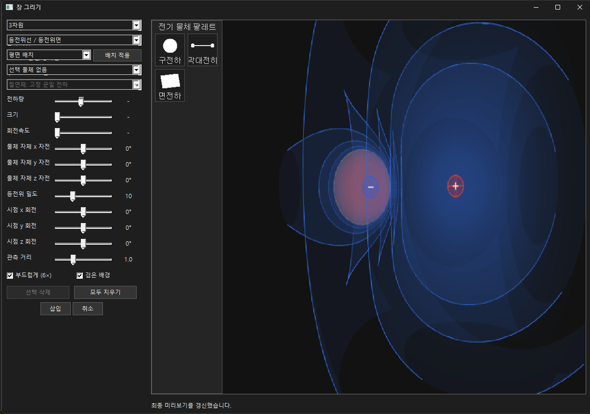

# dotPaint 🎨

**An XP Paint-inspired graphics editor for Windows, with tools for mathematics, physics, and pixel art.**  
**Windows XP 그림판의 간편함에 수학, 물리, 픽셀 아트 도구를 더한 Windows 그래픽 편집기입니다.**

[](https://github.com/eprparadox44/dotPaint/releases/latest)
[](https://github.com/eprparadox44/dotPaint/actions/workflows/build-test.yml)
[](LICENSE)

**[English](#english) · [한국어](#한국어) · [Screenshots / 스크린샷](#screenshots--스크린샷)**

**[⬇️ Download / 다운로드](https://github.com/eprparadox44/dotPaint/releases/latest)** · **[📝 Development blog / 제작 이야기](https://blog.naver.com/jdw1985/224360587153)** · **[📄 Source / 소스 코드](source/)**

> **Current version / 현재 버전: 1.3.7** · Windows x64 / x86 · Go 1.23+

---

## English

dotPaint is a native Windows graphics editor inspired by the straightforward workflow of classic Windows Paint. It supports everyday drawing and precise illustrations, plus specialized editors for mathematical expressions, function graphs, multidimensional shapes, and physical fields.

### Features

- Pencil, brush, eraser, fill, color picker, selections, and image editing
- Shapes, arrows, and vector-style drawing tools
- RGB colors, custom palettes, and 16-color / 256-color indexed palettes
- Layers, transparency, clipboard, undo, and redo
- Flip, mirror, and free-angle rotation with a live preview
- Stretch and skew with percentage/pixel inputs and a resulting-size preview
- Mathematical equation editor and function graph editor
- 3D and 4D geometry visualization
- Electric, magnetic, and gravitational field visualization
- Light and dark themes
- **Korean and English in the same executable**, with instant interface-language switching and a saved language preference

### What's new in 1.3.7

- Korean/English interface switching without restarting the application
- Refined English labels and control layouts
- A cleaner multidimensional shape editor with larger previews and no lengthy explanation panels
- Preserved existing drawing, equation, graph, and physics tools

### Download and run

1. Open the [latest GitHub release](https://github.com/eprparadox44/dotPaint/releases/latest).
2. Download **`dotPaint_1.3.7_x64.exe`** for 64-bit Windows or **`dotPaint_1.3.7_x86.exe`** for 32-bit Windows.
3. Run the downloaded executable. No installer is required.

Use **View → Language** to choose **English** or **한국어**. Changing the language does not require restarting dotPaint.

### Build from source

Requires **Go 1.23 or later**. The main application targets Windows.

```bash
cd source
go test ./...
go vet ./...
```

To build the application, run **`build_1.3.7.bat`** from the repository root on Windows, or **`./build_1.3.7.sh`** in a compatible Bash build environment. Both scripts use the source in `source/`.

> Automated checks verify tests and builds; they do not replace hands-on Windows GUI testing.

---

## 한국어

dotPaint는 Windows XP 그림판의 간편한 작업 흐름을 바탕으로 만든 Windows용 그래픽 편집기입니다. 기본 그림 그리기부터 정밀한 도해 제작까지 지원하며, 수식, 함수 그래프, 다차원 도형, 물리장 시각화 도구도 포함하고 있습니다.

### 주요 기능

- 연필, 브러시, 지우개, 채우기, 색 선택, 선택 영역 및 이미지 편집
- 도형, 화살표 및 벡터 관련 그리기 도구
- RGB 색상, 사용자 팔레트, 16색·256색 인덱스 팔레트
- 레이어, 투명도, 클립보드, 실행 취소 및 다시 실행
- 대칭이동과 자유각 회전, 실시간 미리보기
- 늘이기·기울이기의 백분율/픽셀 양방향 입력과 변경 후 크기 미리보기
- 수식 편집기 및 함수/그래프 편집기
- 3D·4D 도형 시각화
- 전기장·자기장·중력장 등 물리장 시각화
- 라이트·다크 테마
- **하나의 실행파일에서 한국어·영어 즉시 전환**, 언어 설정 저장

### 1.3.7 주요 변경 사항

- 프로그램 재시작 없이 한국어와 영어 인터페이스 전환
- 영어 UI 문구와 입력창 배치 개선
- 다차원 도형 편집기의 긴 설명창 제거 및 미리보기 영역 확대
- 기존 그림, 수식, 그래프, 물리 시각화 기능 유지

### 다운로드 및 실행

1. [최신 GitHub 릴리즈](https://github.com/eprparadox44/dotPaint/releases/latest)를 엽니다.
2. **64비트 Windows**는 **`dotPaint_1.3.7_x64.exe`**, **32비트 Windows**는 **`dotPaint_1.3.7_x86.exe`**를 다운로드합니다.
3. 다운로드한 실행파일을 실행합니다. 별도의 설치 과정은 필요하지 않습니다.

**보기 → 언어**에서 **한국어** 또는 **English**를 선택할 수 있으며, 프로그램을 다시 실행할 필요가 없습니다.

### 소스 코드 빌드

필요 환경은 **Go 1.23 이상**이며, 프로그램 실행 대상은 Windows입니다.

```bash
cd source
go test ./...
go vet ./...
```

Windows에서는 저장소 최상위의 **`build_1.3.7.bat`**, 호환되는 Bash 빌드 환경에서는 **`./build_1.3.7.sh`**를 사용합니다. 두 스크립트 모두 `source/`의 소스를 이용합니다.

> 자동 검증은 코드 검사와 빌드를 수행하며, 실제 Windows GUI 조작 검증을 완전히 대신하지는 않습니다.

---

## Screenshots / 스크린샷

### Main window — Light / 메인 화면 — 라이트 모드


### Main window — Dark / 메인 화면 — 다크 모드


### Flip & Rotate / 대칭이동 및 자유각 회전


### Equation Editor / 수식 편집기


### Function & Graph Editor / 함수 및 그래프 편집기


### 3D & 4D Geometry / 3D·4D 도형 그리기


### Physical Fields / 전기장·자기장·중력장 시각화


> Some screenshots may show earlier versions of the interface. / 일부 스크린샷은 이전 버전의 화면일 수 있습니다.

## Repository layout / 프로젝트 구조

```text
source/                 Go source code and static assets / Go 소스 및 정적 에셋
.github/workflows/      CI checks and builds / 자동 테스트 및 빌드
docs/                   Documentation and screenshots / 문서 및 스크린샷
build_1.3.7.bat         Windows build script / Windows 빌드 스크립트
build_1.3.7.sh          Bash build script / Bash 빌드 스크립트
CHANGELOG.md            Version history / 변경 이력
LICENSE                 MIT license for original code / 자체 코드 MIT 라이선스
THIRD_PARTY_NOTICES.md  Third-party materials / 제3자 자료 관련 안내
```

## License / 라이선스

**Copyright (c) 2026 지너드, G.nerd (eprparadox44)**

Original code owned by the project author is provided under the [MIT License](LICENSE). Check [THIRD_PARTY_NOTICES.md](THIRD_PARTY_NOTICES.md) for licensing considerations concerning third-party images and other materials.

프로젝트 저작자가 권리를 보유한 코드에는 [MIT 라이선스](LICENSE)를 적용합니다. 외부 사진·이미지 및 제3자 자료에는 별도의 이용 조건이 있을 수 있으므로 [제3자 자료 안내](THIRD_PARTY_NOTICES.md)를 확인해 주세요.

---

*dotPaint is an independent project inspired by classic Windows Paint; it is not an official Microsoft product.*  
*dotPaint는 고전 Windows 그림판에서 영감을 받은 독립 프로젝트이며 Microsoft의 공식 제품이 아닙니다.*
