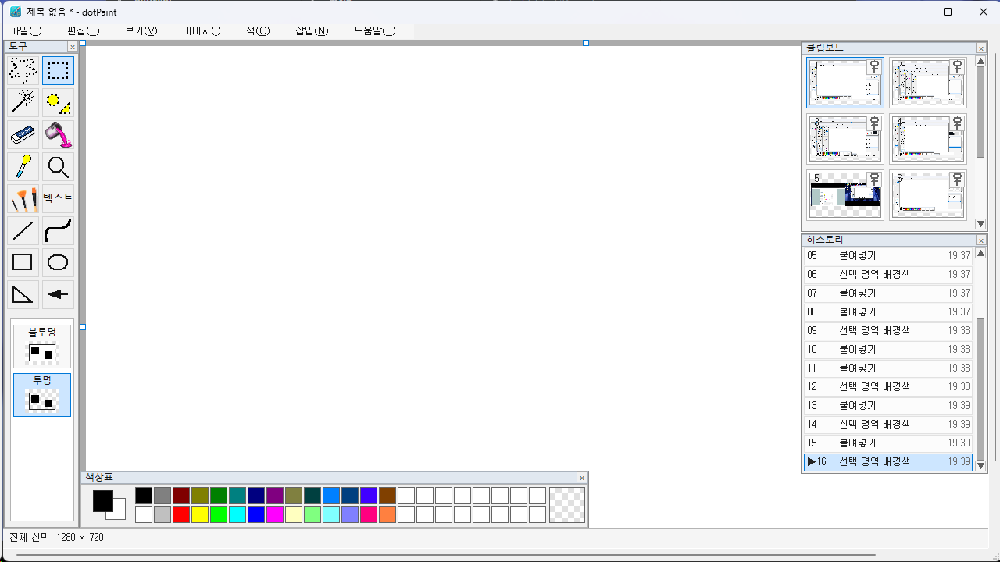
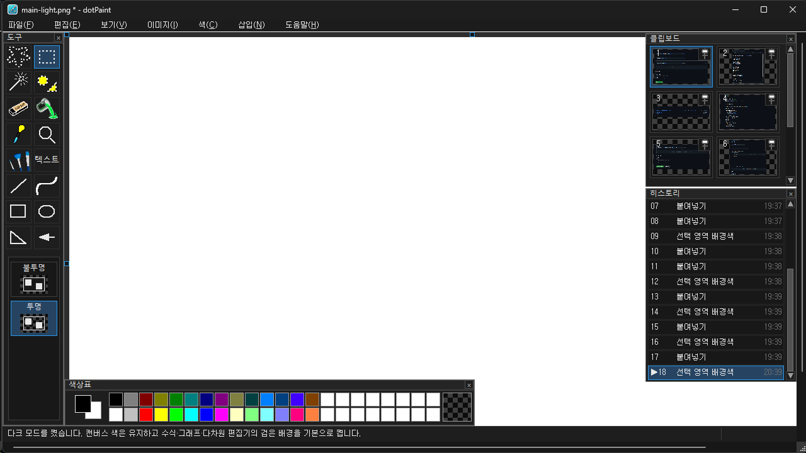

# dotPaint 🎨

**An XP Paint-inspired graphics editor for Windows, with additional tools for mathematics, physics, and pixel art.**

Windows XP 그림판의 간편한 작업 흐름을 바탕으로, 직접 그리기와 정밀한 도해 제작을 함께 지원하는 Windows용 그래픽 편집기입니다.

[](https://github.com/eprparadox44/dotPaint/releases/latest)
[](https://github.com/eprparadox44/dotPaint/actions/workflows/build-test.yml)
[](LICENSE)

**[⬇️ 다운로드 / Downloads](https://github.com/eprparadox44/dotPaint/releases/latest)** · **[📝 제작 이야기 / Blog](https://blog.naver.com/jdw1985/224360587153)** · **[📄 소스 코드 / Source](source/)**

> **현재 소스 버전: 1.3.3** · Windows x64 / x86 · Go 1.23 기반 네이티브 응용 프로그램  
> GitHub Pages는 dotPaint 소개 웹사이트입니다. dotPaint 자체는 Windows에서 실행하는 `.exe`입니다.

## 주요 기능 / Features

- XP 그림판 스타일의 연필·브러시·지우개·채우기·색 선택 및 선택 영역 편집
- 도형 및 화살표, 벡터 관련 그리기 기능
- 색상 편집, 사용자 팔레트, 인덱스 색상(16색·256색) 관련 도구
- 수식과 함수 그래프 편집
- 3D / 4D 도형 시각화
- 전기장·자기장·중력장 등 물리 시각화
- 라이트·다크 테마, 클립보드 및 실행 취소·다시 실행
- 늘이기·기울이기: 백분율/픽셀 양방향 입력, 소수 셋째 자리, 변경 후 크기 미리보기 (v1.3.3)

## 스크린샷 / Screenshots



아래 표의 파일을 추가한 뒤 이미지 링크를 활성화할 수 있습니다.

| 스크린샷 | 파일명 |
|---|---|
| 메인 화면 (라이트) | `docs/screenshots/main-light.png` |
| 메인 화면 (다크) | `docs/screenshots/main-dark.png` |
| 늘이기·기울이기 | `docs/screenshots/stretch-skew.png` |
| 장 시각화 | `docs/screenshots/field-visualization.png` |
| 3D / 4D 도형 | `docs/screenshots/shapes-3d-4d.png` |

<!-- 실제 스크린샷 업로드 후, 아래와 같이 원하는 줄을 활성화하세요.


-->

## 설치 및 실행 / Download & run

1. [Releases](https://github.com/eprparadox44/dotPaint/releases)에서 최신 버전을 엽니다.
2. **64비트 Windows**는 `dotPaint_1.3.3_x64.exe`, **32비트 Windows**는 `dotPaint_1.3.3_x86.exe`를 다운로드합니다 (v1.3.3 기준).
3. 다운로드한 실행파일을 실행합니다.

> 배포 ZIP에도 두 일반판 실행파일이 포함됩니다. 개발 로그판은 일반 사용자용이 아닙니다.  
> Windows GUI 동작은 실제 Windows PC에서 직접 검증해 주세요. CI는 컴파일·코드 검증을 수행합니다.

## 개발자용 빌드 / Build from source

필요 환경: **Go 1.23 이상**, Windows용 크로스 컴파일 지원.

```bash
cd source
go test ./...
go vet ./...
```

Windows에서 저장소 루트의 `build_1.3.3.bat`를 실행하거나, Bash 환경에서 `./build_1.3.3.sh`를 실행합니다. 두 스크립트 모두 `source/`의 전체 코드를 사용합니다.

일반판 EXE 크기 제한은 **10,485,760바이트(10 MiB)**이며 개발 로그판에는 제한을 적용하지 않습니다.

## 프로젝트 구조 / Repository layout

```text
source/                Go 전체 소스 및 빌드에 필요한 정적 에셋
.github/workflows/     GitHub Actions 테스트·빌드
docs/                  GitHub Pages 안내 사이트와 스크린샷
build_1.3.3.bat        Windows 빌드 스크립트
build_1.3.3.sh         Bash 크로스 빌드 스크립트
LICENSE               프로젝트 저작자 소스 코드의 MIT 라이선스
THIRD_PARTY_NOTICES.md 외부 이미지·자료의 권리 확인 메모
```

## 라이선스 / License

**저작권: Copyright (c) 2026 지너드, G.nerd (eprparadox44)**

프로젝트 저작자가 권리를 보유한 코드에는 [MIT License](LICENSE)를 적용합니다. **외부 사진·이미지·제3자 자료의 이용 조건은 별도로 확인**해야 하므로 [THIRD_PARTY_NOTICES.md](THIRD_PARTY_NOTICES.md)를 읽어주세요.

---

*dotPaint is an independent project inspired by classic Windows Paint; it is not an official Microsoft product.*
